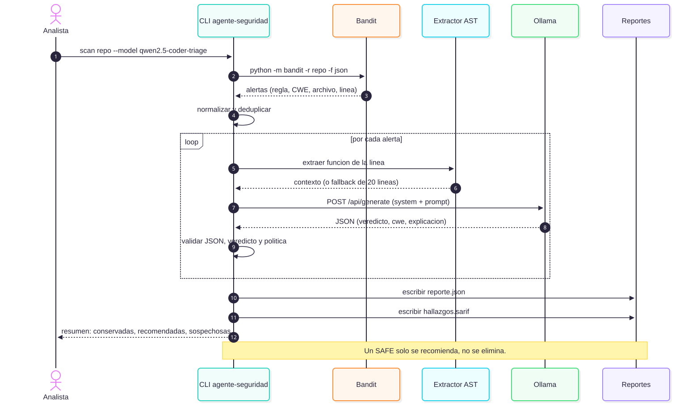

# Arquitectura — arc42 y C4

Documento de arquitectura del agente de triage. Sigue la plantilla **arc42 9.1**
(edición en inglés; la 8.3 es la traducción al español) y usa el modelo **C4** de
Simon Brown para las vistas de contexto y contenedores. Las secciones de arc42
que no aplican a un producto local de un solo proceso se declaran como tales en
lugar de rellenarse.

Los diagramas viven en `docs/diagramas/*.mmd` y se renderizan con Mermaid CLI
12.2.0 (`npx @mermaid-js/mermaid-cli`). El `.mmd` es la fuente; las imágenes se
regeneran, no se editan a mano.

## 1. Introducción y objetivos

El sistema reduce el trabajo de revisión de alertas de Bandit sobre código
Python. No detecta vulnerabilidades nuevas ni reemplaza al analista: recibe una
alerta del SAST y emite una **recomendación** —`VULNERABLE` o `SAFE`— con una
explicación. Por contrato, una alerta nunca se elimina del reporte.

Requisitos que gobiernan la arquitectura:

| Prioridad | Requisito | Criterio verificable |
|---|---|---|
| 1 | No perder alertas | `total == conservadas` en todo reporte; un `SAFE` no borra el hallazgo. |
| 2 | Ejecución local | El código analizado no sale del equipo; no hay API externa. |
| 3 | Degradación segura | Sin Ollama, JSON inválido o timeout, la alerta queda `SOSPECHOSA`. |
| 4 | Reproducibilidad | Versiones, prompts y hashes registrados; el reporte es JSON estable. |
| 5 | Coste acotado | Modelo de 1,5B en Q4_K_M, menos de 2 GB de VRAM y generación limitada. |
| 6 | Interoperabilidad | Salida JSON propia y SARIF 2.1.0 para consumidores existentes. |

**Stakeholders.** Analista de seguridad (opera la CLI y revisa), autor del
proyecto (mantiene el modelo y la evaluación) y consumidor del reporte
(frontend o pipeline de CI). El analista es el único que decide qué se corrige.

## 2. Restricciones

| Restricción | Origen | Consecuencia |
|---|---|---|
| Solo Python | Bandit analiza Python | El corpus C del dataset se descarta para la evaluación. |
| Solo reglas de Bandit | Herramienta elegida | La cobertura OWASP es parcial; no hay flujo de datos ni alcanzabilidad. |
| Modelo ≤ 2B y GGUF | GPU de 4 GB | Se elige Qwen2.5-Coder-1.5B Instruct y Q4_K_M. |
| Sin API externa | Requisito de privacidad | La inferencia pasa por Ollama en `localhost`. |
| Un proceso, sin servidor | Alcance del proyecto | No hay cola, base de datos ni autenticación. |
| Holdout cerrado | Protocolo de evaluación | No se reajustan prompts ni reglas con el test. |

## 3. Contexto y alcance

El agente es la caja central. Bandit es un sistema externo que se ejecuta como
subproceso; Ollama es un runtime externo que se consume por HTTP local; el
repositorio y los reportes son almacenamiento del sistema anfitrión. El
consumidor de reportes no forma parte del despliegue: lee archivos.

**Fuera del alcance:** interfaz web autenticada, gestión de usuarios, escaneo de
dependencias, análisis de flujo entre archivos, ejecución de la aplicación
analizada y corrección automática del código.

La vista de contenedores muestra las piezas desplegables y los límites de
confianza: la CLI concentra la orquestación y la política; Ollama sirve el
modelo por HTTP de loopback; los reportes quedan en disco y los consume el
revisor.

## 4. Estrategia de solución

1. **Separar heurística de modelo.** Bandit decide qué es una alerta; el modelo
   solo decide si la alerta parece real. El CWE se conserva del SAST.
2. **Contexto mínimo y verificable.** Se extrae la función que contiene la línea
   con `ast`; si no hay AST, se usan 20 líneas alrededor. No se envía el
   repositorio completo.
3. **Contrato conservador.** Cualquier fallo de formato, conexión o validación
   produce `SOSPECHOSA`. `SAFE` solo se acepta con justificación y nunca para
   reglas protegidas (`B403` por defecto).
4. **Una sola pasada.** El escaneo es secuencial y determinista
   (`temperature: 0`). La reproducibilidad importa más que el rendimiento.
5. **Trazabilidad.** Cada alerta conserva `rule_id`, CWE, archivo, línea,
   función, contexto y la respuesta del modelo.

## 5. Vista de bloques

| Bloque | Responsabilidad | Archivo |
|---|---|---|
| CLI | Parseo de argumentos, orquestación, códigos de salida | `agente/src/agente_seguridad/cli.py` |
| Runner SAST | Ejecuta Bandit, normaliza la salida y arma `Finding` | `sast/bandit_runner.py` |
| Contexto | Recorta la función o el entorno de la línea | `context.py` |
| Deduplicación | Huella por regla, archivo y contexto normalizado | `dedup.py` |
| Triage | Prompt, llamada al modelo, parseo y política | `triage.py` |
| Cliente LLM | HTTP contra Ollama, timeout y `num_predict` | `llm/ollama_client.py` |
| Reporte | Resumen en modo asesor, JSON y SARIF | `report.py`, `sast/sarif.py` |
| Modelo de datos | `Finding`, `ToolRun`, `Scan`, `TriageResult` | `models.py` |

La dependencia es unidireccional: `cli → sast/context/dedup/triage/report`. El
cliente de Ollama es la única pieza que conoce un protocolo de red; el resto
trabaja con objetos en memoria.

## 6. Vista de ejecución

Puntos de decisión:

- **Bandit falla o no devuelve JSON:** el proceso termina con código 3 y no
  escribe un reporte vacío que parezca un escaneo exitoso.
- **Ollama no responde:** se avisa, todas las alertas quedan `SOSPECHOSA` y el
  proceso termina con código 0. El reporte sigue siendo válido.
- **Respuesta no parseable, veredicto inválido o SAFE sin explicación:** la
  alerta queda `SOSPECHOSA` con `origen: respaldo`.
- **SAFE sobre una regla protegida:** se convierte en `SOSPECHOSA` con
  `origen: politica_seguridad`; no se pierde la recomendación original.

## 7. Vista de despliegue

Todo ocurre en un equipo. El artefacto desplegable es el paquete Python más el
modelo registrado en Ollama; no hay contenedores ni servicios en la nube. El
modelo ocupa 940 MB en disco y 1.115 MB de VRAM con contexto de 4.096 tokens.
Durante el escaneo no se requiere red externa: solo la interfaz de loopback.

## 8. Conceptos transversales

**Modo asesor.** El resumen distingue `conservadas` (siempre igual a `total`),
`recomendadas_descarte`, `sospechosas` y `errores_modelo`. La consola no usa la
palabra «descartadas». Es el control central frente a LLM06 Excessive Agency.

**Política de no descarte.** `DEFAULT_NEVER_DISCARD = {"B403"}` en `triage.py`.
Se puede ampliar con `--never-discard`, pero no desactivar sin cambiar código.
La política se aplica después del parseo y antes del reporte.

**Validación de salida.** `_clean_json` tolera cercas Markdown y texto alrededor
del objeto; luego se exige `veredicto` en `{VULNERABLE, SAFE}`, severidad válida
y justificación no vacía para `SAFE`. El CWE del modelo no se usa para
sobrescribir el del SAST en el reporte de producto.

**Consumo acotado.** `num_predict: 512` y timeout de 180 s. Un bucle de
generación se convierte en respuesta inválida, no en un proceso colgado.

**Privacidad.** El código entra completo al prompt y queda en el reporte. La
mitigación es la ejecución local; la retención de reportes es una decisión
operativa que debe documentarse en el despliegue.

**Observabilidad.** No hay métricas en runtime. La evidencia es el reporte:
conteos por veredicto, por severidad y por CWE, más los errores de modelo.

**Idempotencia.** El `scan_id` incluye la marca de tiempo; dos corridas producen
reportes distintos aunque el contenido sea equivalente. La deduplicación es
dentro de una corrida, no entre corridas.

## 9. Decisiones de arquitectura

| Decisión | Alternativa descartada | Motivo |
|---|---|---|
| Bandit como único SAST | Semgrep, CodeQL | Instalación simple, salida JSON estable y CWE por alerta. |
| Qwen2.5-Coder-1.5B | Modelos de 7B o API | Cabe en 4 GB de VRAM y se ejecuta en local. |
| LoRA + fusión + GGUF | Solo prompt o RAG | El objetivo era medir el efecto del ajuste, no recuperar contexto. |
| Modo asesor | Descarte automático | El FNR medido impide suprimir alertas. |
| CWE del SAST | CWE del modelo | El modelo copia la entrada y no mejora la exactitud. |
| Secuencial | Paralelizar alertas | La GPU es el cuello de botella; el paralelismo no se midió. |
| JSON + SARIF | Solo JSON | SARIF permite integrar el reporte en herramientas existentes. |

## 10. Requisitos de calidad

| Atributo | Escenario | Medida |
|---|---|---|
| Seguridad | Un SAFE no elimina la alerta | `conservadas == total`; prueba `test_safe_is_kept_and_only_recommended`. |
| Disponibilidad | Ollama caído | 100 % de alertas como `SOSPECHOSA`, exit 0, reporte válido. |
| Rendimiento | 9 alertas en una GTX 1650 | 43,1 s totales, ~4,8 s por alerta. |
| Capacidad | Modelo en Q4_K_M | 1.115 MB de VRAM, 940 MB en disco. |
| Corrección | JSON inválido o veredicto fuera de catálogo | Degradación a `SOSPECHOSA`, contada como respuesta inválida. |
| Mantenibilidad | Cambio de modelo | `--model` y `--ollama-url` sin tocar código. |
| Portabilidad | Windows y Linux | Solo depende de Python, Bandit, requests y Ollama. |

## 11. Riesgos y deuda técnica

| Riesgo | Impacto | Mitigación actual | Trabajo pendiente |
|---|---|---|---|
| Prompt de evaluación distinto al de producto | Las métricas no describen exactamente la CLI | Declarado en `docs/BORRADOR_ANEXOS.md` | Alinear y medir sin reutilizar el holdout. |
| Frontend rotula los SAFE como «descartadas» | Percepción de supresión | El JSON y el SARIF conservan todo | Rotular como «recomendadas» y distinguir SOSPECHOSA. |
| Sin autenticación ni control de acceso | Cualquiera con acceso al equipo lee reportes | Ejecución local | Política de retención y permisos de carpeta. |
| Dependencia de una etiqueta de Ollama | El modelo puede cambiar sin cambiar el código | `training/out/SHA256SUMS.txt` | Fijar el modelo base por `revision` y verificar el hash al desplegar. |
| Escaneo secuencial | Repos grandes tardan | `--max-alerts` | Medir paralelismo con la GPU objetivo. |
| Sin análisis de flujo | Falsos negativos estructurales | Modo asesor | Declarar el alcance; no prometer cobertura total. |

## 12. Glosario

- **Alerta:** resultado de Bandit para una regla, archivo y línea.
- **Triage:** recomendación del modelo sobre si la alerta es real.
- **SAFE:** recomendación de descarte; no elimina la alerta.
- **SOSPECHOSA:** alerta sin respuesta válida o protegida por política.
- **Modo asesor:** contrato por el que ninguna alerta se suprime.
- **C4:** modelo de contexto, contenedores, componentes y código.
- **arc42:** plantilla de documentación de arquitectura en 12 secciones.
